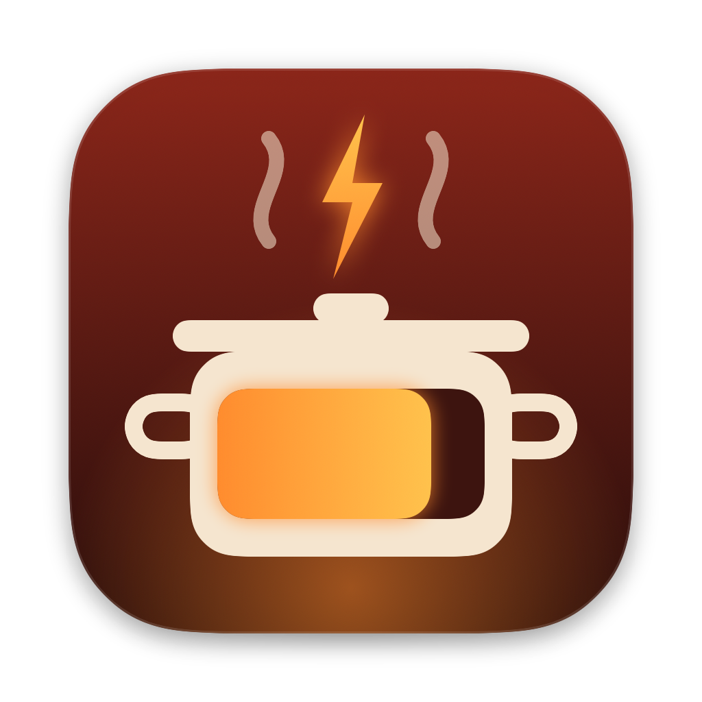

<p align="center"></p>

<h1 align="center">Stracotto</h1>
<p align="center">Low-and-slow battery care for your Mac's menu bar.</p>

## Download

**[⬇ Download the latest Stracotto.dmg](https://github.com/mks909/Stracotto/releases/latest/download/Stracotto.dmg)**

Open the DMG and drag **Stracotto** into **Applications**. Requires macOS 27 and a MacBook.

> The build is signed for development but not notarized yet. The first time you open it, right-click the app → **Open**,
> or allow it under System Settings → Privacy & Security.

## What it does

- **Charge limit:** holds the battery at 80, 85, 90 or 95 % using macOS's built-in charge limit, and stays in sync with
  System Settings → Battery → Charging. No admin helper needed.
- **Top Up:** charges to 100 % once, then returns to your limit when you unplug.
- **Live menu bar battery:** a pill battery with the percentage inside that animates on plug-in, plus a flame when an app
  uses a lot of energy. Choose iOS Native, AlDente Status or Percentage Only, and add extra stats.
- **Power Flow:** a live Sankey of watts from the charger and battery, into the Mac, out to the SoC and the rest of the
  system.
- **Apps Using Significant Energy:** per-app watts from the kernel's energy counters, with Quit buttons.
- **Specifications:** health (matches System Settings), cycles, temperature, time remaining, current, voltage, power
  and system load.
- **Schedule:** timed tasks with templates, repeats, catch-up and history.

Discharge, Heat Protection, Sailing Mode, Calibration, the MagSafe LED and limits below 80 % are in the UI but marked
**Saved only**. macOS's limit can't enforce them; they need a privileged helper that isn't written yet.

## Build

```sh
brew install xcodegen
xcodegen generate
xcodebuild -project Stracotto.xcodeproj -scheme Stracotto -configuration Release -derivedDataPath build build
open build/Build/Products/Release/Stracotto.app
```

Debug flags: `--dump` prints the live battery reading; `--snapshot <dir>` renders the popover in every state to PNG;
`--export-icon <file.png>` renders the app icon.

## How charge control works on macOS 27

macOS 27 removed the SMC keys older tools used (`CH0B`, `CH0C`, `CHTE`). The new ones (`CHLS`, `CH0J`) and the
`IOPSLimitBatteryLevel` SPI reject even root. The Battery settings pane instead talks to PowerUI's
`PowerUISmartChargeClient`, which accepts `getMCLLimit`, `setMCLLimit:` (80–100 in steps of 5) and
`temporarilyOverrideMCLTargetSoC:` from a normal app. See `App/MCLClient.swift`; the probes in `tools/` document how
this was found.
