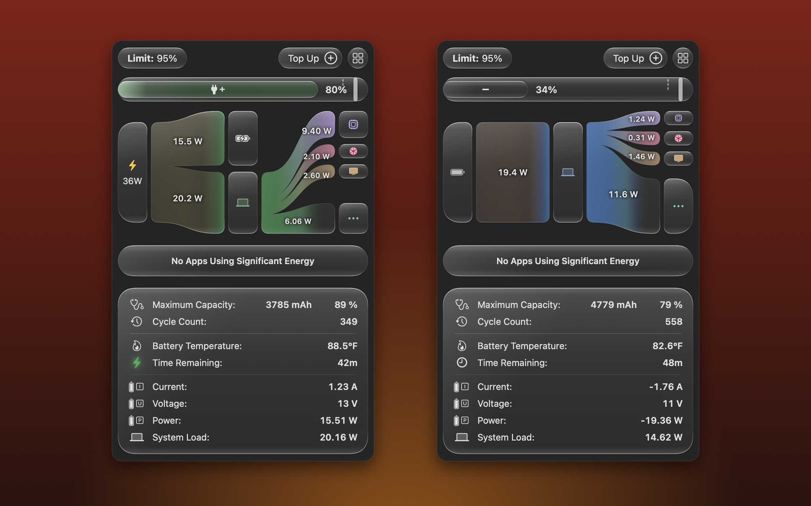
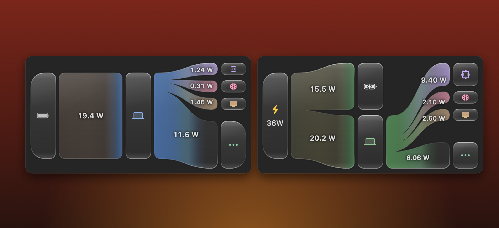
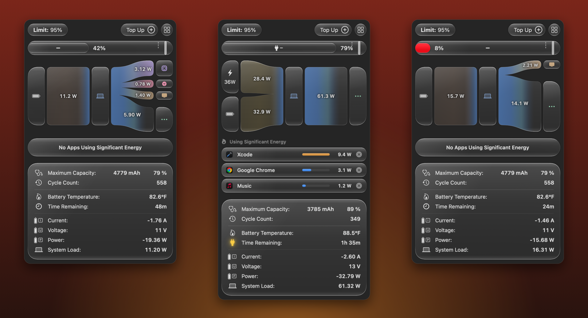
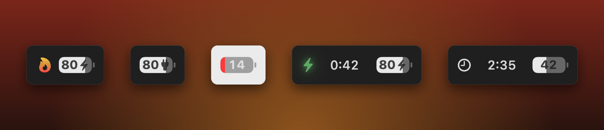

<p align="center">
  
</p>

<h1 align="center">Stracotto</h1>

<p align="center">
  <b>Low and slow battery care for your Mac.</b><br>
  A charge limit, live power flow and every number that matters, right in your menu bar.
</p>

<p align="center">
  <a href="https://github.com/mks909/Stracotto/releases/latest/download/Stracotto.dmg"><b>⬇&nbsp; Download for Mac</b></a>
  &nbsp;·&nbsp; macOS 27 &nbsp;·&nbsp; Apple silicon MacBooks &nbsp;·&nbsp; Free
</p>

<p align="center">
  
</p>

---

## See where every watt goes

<p align="center"></p>

**Power Flow** draws your Mac's power as it moves: from the charger or battery, into the Mac, and out to the CPU, GPU,
display and everything else. (The GPU and display branches are estimates: macOS only reports their power to root, so
Stracotto derives them from GPU load and your backlight level.) Each branch carries its live wattage and the colour flows the way the energy does:
warm at the source, blue through the Mac, lavender at the CPU, rose at the GPU, amber at the display, green and gold
while charging.
Tap any node for the detail behind it: the apps working your CPU, your display's brightness, the charger's negotiated
voltage, the battery's health.

## Keep your battery young

Lithium-ion cells age fastest when they sit full. Stracotto holds your Mac at **80, 85, 90 or 95 %** using macOS's own
charge limit, so it keeps working after you quit and stays in sync with System Settings. Drag the marker on the bar or
pick from the Limit chip; every step clicks into place with a haptic tick.

Need a full battery for the day? **Top Up** charges to 100 % once (green stripes roll through the bar while it does),
then goes back to your limit when you unplug.

## Every state, at a glance

<p align="center"></p>

The bar tells you what the battery is doing before you read a number: green while charging, blue while it rests at the
limit, slate on battery, and solid red when it's low. Time remaining comes straight from the battery's gas gauge, and
while charging it counts down to *your limit*, not to 100 %, accounting for the slower top end of a charge.

## A battery icon that's alive

<p align="center"></p>

Stracotto's menu bar battery takes the place of the system one. The percentage sits inside the cell, it flashes green
with a sweep of light the moment you plug in, turns red when you're low, and a flame appears when an app starts pulling
serious power. Add temperature, watts or time remaining beside it, or switch to a text-only style. The time readout carries its own
icon: a clock on battery, a softly glowing green bolt while charging, a yellow plug when you're plugged in but not
filling.

## Everything else

- **Apps Using Significant Energy:** per-app watts from the kernel's energy counters, with one-click Quit
- **Specifications:** maximum capacity (matching System Settings), cycles, temperature, current, voltage, power and
  system load
- **Schedule:** set limits, Top Up or Low Power Mode on a timetable, with templates, catch-up after sleep and history
- **Make it yours:** System, Light or Dark; solid or Liquid Glass surfaces; choose which widgets the popover shows
- **Light on your Mac:** the popover's animations only run while it's open; idle, Stracotto sits near 0 % CPU

## Install

1. [Download **Stracotto.dmg**](https://github.com/mks909/Stracotto/releases/latest/download/Stracotto.dmg) and drag
   Stracotto into Applications.
2. Open it. The first launch may ask you to confirm: right-click → **Open**, or allow it in
   System Settings → Privacy & Security.
3. Optional: hide the system battery icon (System Settings → Control Center → Battery) so Stracotto's takes its place.
   The popover offers a shortcut.

<details>
<summary><b>Build from source</b></summary>

```sh
brew install xcodegen
xcodegen generate
xcodebuild -project Stracotto.xcodeproj -scheme Stracotto -configuration Release -derivedDataPath build build
open build/Build/Products/Release/Stracotto.app
```

Developer flags: `--dump` prints the live battery reading, `--snapshot <dir>` renders the popover in every state,
`--flow-frames <dir>` renders Power Flow over time, `--export-icon <file.png>` renders the app icon.
</details>

<details>
<summary><b>How charge control works on macOS 27</b></summary>

macOS 27 removed the SMC keys older tools relied on (`CH0B`, `CH0C`, `CHTE`), and the new ones (`CHLS`, `CH0J`) and the
`IOPSLimitBatteryLevel` SPI reject even root. The Battery settings pane uses PowerUI's `PowerUISmartChargeClient`,
which accepts `getMCLLimit`, `setMCLLimit:` (80–100 in steps of 5) and `temporarilyOverrideMCLTargetSoC:` from a normal
app, with no helper or admin rights. See `App/MCLClient.swift`; the probes in `tools/` document how it was found.

Discharge, Heat Protection, Sailing Mode, Calibration, the MagSafe LED and limits below 80 % appear in Settings as
**Saved only**: macOS's limit can't enforce them, and they need a privileged helper that isn't written yet.
</details>

<p align="center"><sub>Made in Frisco, TX · Stracotto is an Italian braise, cooked low and slow for hours. Your battery deserves the same.</sub></p>
